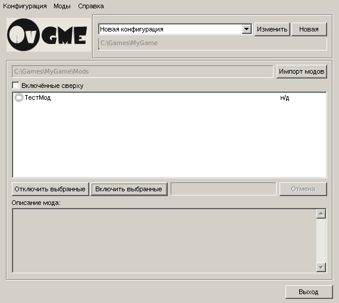

----------------------------------------------------------------------------------------
#OvGME (русская версия)
Расширенный универсальный включатель и менеджер модов (Generic Mod Enabler).
----------------------------------------------------------------------------------------
Версия: 1.7.4
----------------------------------------------------------------------------------------

Домашняя страница оригинала: https://github.com/sedenion/ovgme

Это форк OvGME с полностью русским интерфейсом: меню, диалоги, сообщения и встроенная
справка переведены на русский язык, функциональность сохранена без изменений.

Описание
----------------------------------------------------------------------------------------
OvGME — менеджер модов, основанный на идее и концепции JSGME; от JSGME он унаследовал
сокращение GME — Generic Mod Enabler. Главная задача OvGME — дать простой способ
импортировать и включать моды для игр, а затем восстанавливать оригинальные файлы при
отключении модов. OvGME сравнивает дерево файлов папки назначения с деревом файлов мода
и определяет, какие файлы заменить, создать и сохранить в резервной копии.

Основные возможности OvGME:

- Несколько папок назначения (игр, программ и т. д.) в одном окне.
- Своя папка с модами и папка резервных копий для каждой папки назначения.
- Снимок дерева файлов папки назначения и сравнение с ним на основе xxHash.
- Моды в виде zip-архивов (мод-архивы).
- Описания модов (readme.txt).
- Версии модов.
- Профили включённых модов для каждой папки назначения.
- Сетевые репозитории модов.
- Загрузка и обновление модов через Интернет.
- Инструмент создания zip мод-архивов.
- Инструмент создания XML-файла репозитория.
- Подробная встроенная справка.

###Если вы уже пользуетесь JSGME
Прежде чем что-либо делать, внимательно прочитайте раздел «OvGME и JSGME» во встроенной
справке.

Сборка
----------------------------------------------------------------------------------------
Под Windows: откройте `OvGME.cbp` в Code::Blocks (MinGW) и соберите проект; справку
соберите командой `help\build.bat` (нужен HTML Help Workshop), затем положите
`help\ru\ovgme.chm` рядом с `OvGME.exe`.

Под Linux (кросс-сборка): установите `g++-mingw-w64-x86-64` (и при желании `fp-utils`
для сборки справки утилитой `chmcmd`) и выполните `./build.sh` — результат появится в
папке `bin/`.

Снимки экрана
----------------------------------------------------------------------------------------

